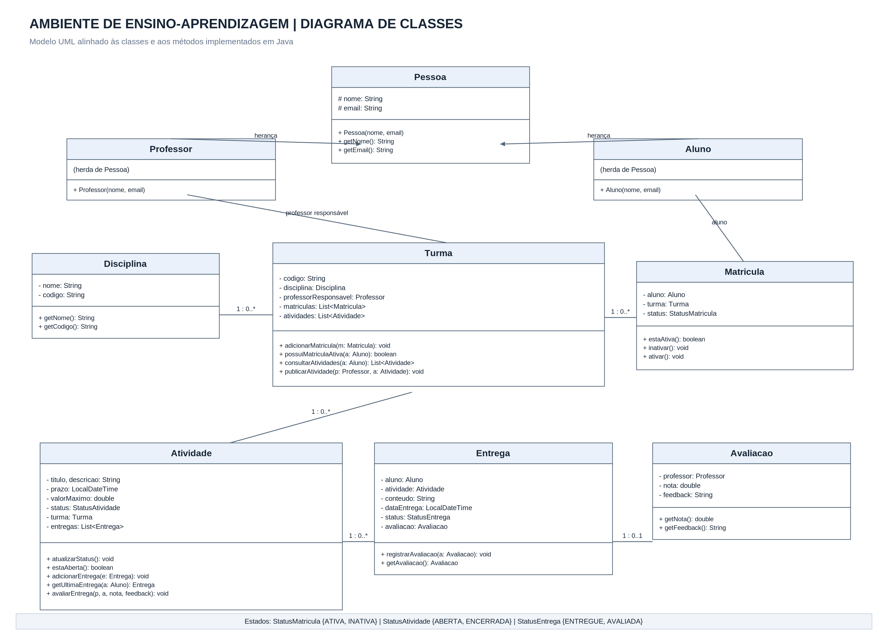
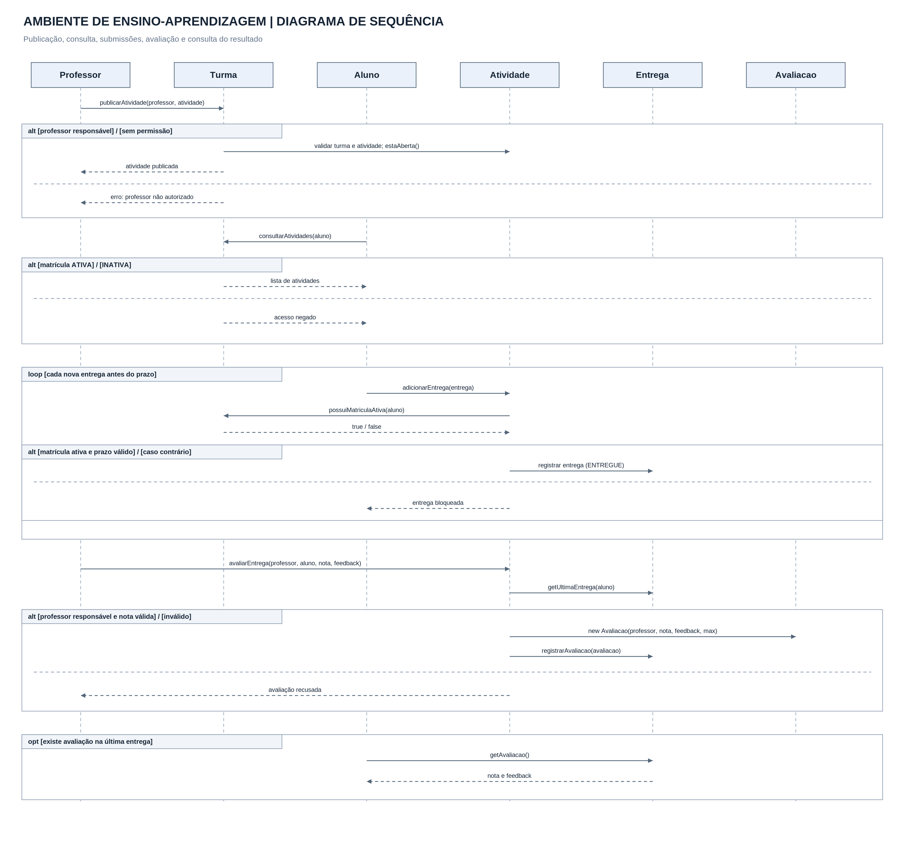

# Ambiente de Ensino-Aprendizagem

Projeto desenvolvido em Java como atividade prática da disciplina de Análise e Orientação a Objetos.

## 1. Descrição do projeto

O projeto apresenta uma implementação de um ambiente de ensino-aprendizagem, utilizando os conceitos de Programação Orientada a Objetos.

O sistema permite que professores publiquem atividades para suas turmas, alunos matriculados consultem e realizem entregas, e professores responsáveis registrem avaliações com notas e feedbacks.

## 2. Funcionalidades

- Cadastro de professores, alunos, disciplinas e turmas.
- Controle de matrículas com estados `ATIVA` e `INATIVA`.
- Publicação de atividades pelo professor responsável pela turma.
- Consulta de atividades por alunos com matrícula ativa.
- Registro de múltiplas entregas dentro do prazo.
- Armazenamento do histórico de entregas.
- Avaliação da entrega mais recente do aluno.
- Registro de nota e feedback.
- Bloqueio de entregas após o encerramento do prazo.

## 3. Regras de negócio

**RN01 — Publicação:** somente o professor responsável pela turma pode publicar atividades.

**RN02 — Matrícula:** somente alunos com matrícula ativa podem consultar atividades e registrar entregas.

**RN03 — Entregas:** um aluno pode realizar mais de uma entrega para a mesma atividade enquanto o prazo estiver aberto.

**RN04 — Histórico:** todas as entregas são preservadas, e a avaliação considera a entrega mais recente.

**RN05 — Prazo:** atividades possuem os estados `ABERTA` e `ENCERRADA`. Após o prazo, novas entregas são bloqueadas.

**RN06 — Avaliação:** somente o professor responsável pode avaliar. A nota deve estar entre zero e o valor máximo da atividade, e a avaliação registra um feedback.

**RN07 — Estado da entrega:** uma entrega começa como `ENTREGUE` e passa para `AVALIADA` após a avaliação.

## 4. Diagrama de Classes UML

O diagrama apresenta as classes, seus atributos, métodos, relacionamentos e estados utilizados no sistema.

## 5. Diagrama de Sequência UML

O diagrama representa o fluxo de publicação, consulta, entregas e avaliação, incluindo os fragmentos `alt`, `loop` e `opt`.

## 6. Tecnologias utilizadas

- Java
- Apache NetBeans
- UML
- GitHub

## 7. Execução e testes

A classe `Principal.java` contém uma demonstração das principais funcionalidades e regras de negócio.

Foram realizados testes de publicação de atividade, consulta por aluno matriculado, múltiplas entregas, avaliação com nota e feedback, bloqueio de acesso por matrícula inativa e bloqueio de entregas após o prazo.

A execução foi concluída com a mensagem `BUILD SUCCESSFUL` no NetBeans.

## 8. Como executar

1. Abra o projeto Java no Apache NetBeans ou em outro ambiente compatível.
2. Compile os arquivos `.java` utilizando o JDK.
3. Execute a classe `Principal.java`.
4. Acompanhe os resultados dos testes no console.

## 9. Estrutura do código

O projeto contém as classes `Pessoa`, `Professor`, `Aluno`, `Disciplina`, `Turma`, `Matricula`, `Atividade`, `Entrega`, `Avaliacao` e `Principal`, além dos enums `StatusMatricula`, `StatusAtividade` e `StatusEntrega`.

## 10. Demonstração em vídeo

Vídeo de demonstração do funcionamento do sistema: **link a adicionar após a gravação**.
